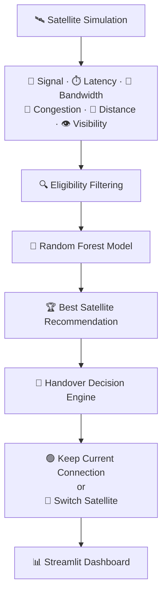
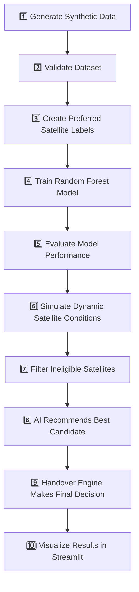
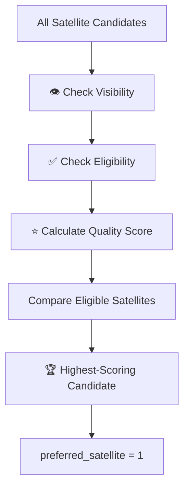
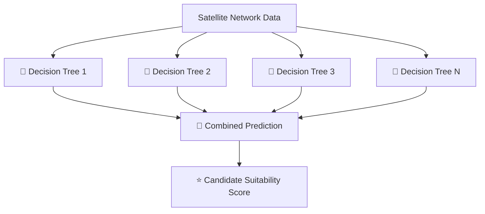
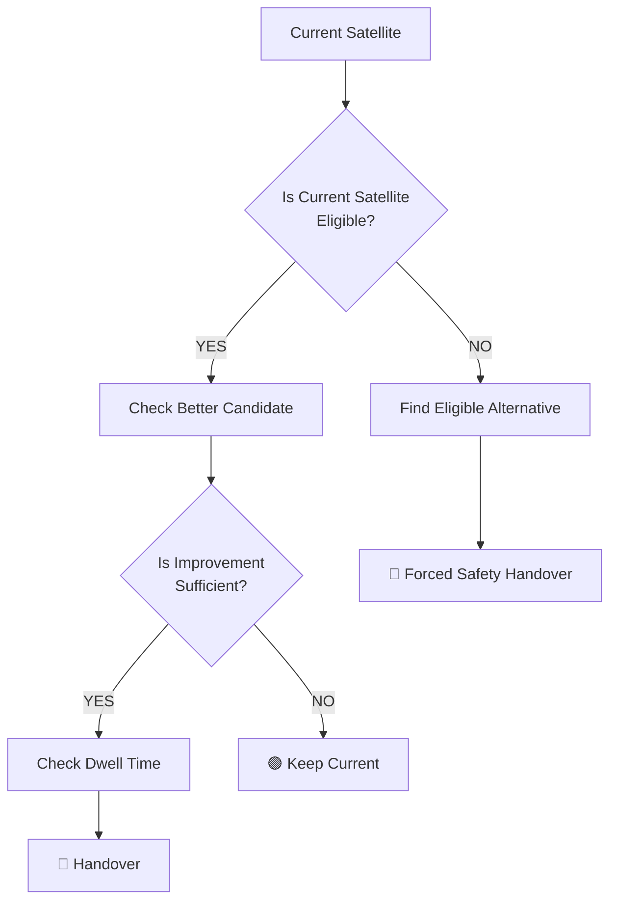

div align="center">
# 🛰️ AI-Based Satellite Handover Decision System
 
**An AI-assisted simulation system that evaluates multiple Low Earth Orbit (LEO) satellite candidates and supports intelligent satellite handover decisions based on changing network conditions.**
 


 
</div>
---
 
## 📑 Table of Contents
 
- [Project Overview](#-project-overview)
- [Project Objectives](#-project-objectives)
- [System Architecture](#️-system-architecture)
- [Complete Workflow](#-complete-workflow)
- [Project Structure](#-project-structure)
- [Technology Stack](#️-technology-stack)
- [Installation and Setup](#-installation-and-setup)
- [Phase 1 — Synthetic Data Generation](#-phase-1--synthetic-data-generation)
- [Phase 2 — Machine Learning Model](#-phase-2--machine-learning-model)
- [Phase 3 — Intelligent Handover Engine](#-phase-3--intelligent-handover-engine)
- [Phase 4 — Streamlit Dashboard](#️-phase-4--streamlit-dashboard)
- [AI vs Baseline Comparison](#️-ai-vs-baseline-comparison)
- [Running the Handover Simulation](#-running-the-handover-simulation)
- [Important Limitations](#️-important-limitations)
- [Future Improvements](#-future-improvements)
- [Key Project Concept](#-key-project-concept)
- [Quick Summary](#-quick-summary)
- [Author](#-author)
---
 
## 📌 Project Overview
 
In a Low Earth Orbit (LEO) satellite network, satellites continuously move relative to a ground user. As a result, connection quality can change over time.
 
A connected satellite may experience:
 
- 📶 Weak signal strength
- ⏱️ Increased latency
- 📉 Reduced bandwidth
- 🚦 High congestion
- 👁️ Loss of visibility
The system answers two questions:
 
1. 🤖 **Which satellite is currently the best candidate?**
2. 🔄 **Should the connection actually be switched to that satellite?**
This project simulates multiple satellites with changing network conditions and uses a **Random Forest** machine learning model together with an **intelligent handover decision engine**.
 
---
 
## 🎯 Project Objectives
 
- 🛰️ Simulate multiple LEO satellite candidates.
- 📊 Generate synthetic satellite-network scenarios.
- 🤖 Train a machine-learning model to identify preferred satellite candidates.
- 🔍 Evaluate multiple network parameters instead of relying only on signal strength.
- 🔄 Decide when a satellite handover should occur.
- 🛡️ Reduce unnecessary switching using stability rules.
- 📈 Visualize the simulation using an interactive Streamlit dashboard.
- ⚖️ Compare AI-assisted decisions with a simpler baseline approach.
---
 
## 🏗️ System Architecture
 

 
---
 
## 🔄 Complete Workflow
 

 
---
 
## 📁 Project Structure
 
```text
AI-Based-Satellite-Handover-Decision-System/
│
├── app.py
├── generate_data.py
├── train_model.py
├── handover_engine.py
├── requirements.txt
├── README.md
├── report.md
│
├── data/
│   └── satellite_dataset.csv
│
├── models/
│   └── handover_model.joblib
│
└── outputs/
    ├── classification_report.txt
    ├── confusion_matrix.png
    ├── evaluation_metrics.json
    └── top1_comparison.png
```
 
---
 
## ⚙️ Technology Stack
 
| Technology | Purpose |
|---|---|
| 🐍 **Python** | Core programming language |
| 🔢 **NumPy** | Numerical simulation |
| 🐼 **Pandas** | Dataset creation and processing |
| 🤖 **Scikit-learn** | Random Forest machine-learning model |
| 💾 **Joblib** | Saving and loading the trained model |
| 📊 **Matplotlib** | Model evaluation visualizations |
| 📈 **Plotly** | Interactive charts |
| 🎛️ **Streamlit** | Interactive dashboard |
 
---
 
## 🚀 Installation and Setup
 
### 1️⃣ Clone the Repository
 
```bash
git clone https://github.com/Haneesh1401/AI-Based-Satellite-Handover-Decision-System.git
cd AI-Based-Satellite-Handover-Decision-System
```
 
### 2️⃣ Create a Virtual Environment
 
**Windows PowerShell**
 
```powershell
py -m venv .venv
.\.venv\Scripts\Activate.ps1
```
 
### 3️⃣ Install Dependencies
 
```bash
python -m pip install --upgrade pip
pip install -r requirements.txt
```
 
---
 
## 📊 Phase 1 — Synthetic Data Generation
 
### Purpose
 
This project uses **synthetic data** and does not connect to real satellites or real telemetry.
 
The default dataset contains:
 
> **3,000 scenarios × 6 satellites = 18,000 candidate records**
 
### Run
 
```bash
python generate_data.py
```
 
The dataset is saved to:
 
```text
data/satellite_dataset.csv
```
 
### 🛰️ Dataset Features
 
Each row represents one satellite candidate within one simulation scenario.
 
| Feature | Description |
|---|---|
| 🆔 `scenario_id` | Scenario grouping identifier |
| 🛰️ `satellite_id` | Synthetic satellite identifier |
| 📶 `signal_dbm` | Simulated received signal strength |
| ⏱️ `latency_ms` | Simulated network latency |
| 📡 `bandwidth_mbps` | Simulated available bandwidth |
| 🚦 `congestion_pct` | Simulated network congestion |
| 📍 `distance_km` | Simulated satellite distance |
| 👁️ `visible` | Satellite visibility status |
| ✅ `eligible` | Whether minimum quality conditions are satisfied |
| ⭐ `quality_score` | Rule-based satellite quality score |
| 🎯 `preferred_satellite` | Target label for ML training |
 
### 🏆 Preferred Satellite Label
 

 
> ⚠️ **Note:** Invisible or ineligible satellites are never labelled as valid preferred targets.
 
---
 
## 🤖 Phase 2 — Machine Learning Model
 
The project uses a **Random Forest Classifier**.
 
The model learns relationships between satellite-network conditions and synthetic preferred-satellite labels.
 
### Input Factors
 
- 📶 Signal strength
- ⏱️ Latency
- 📡 Bandwidth
- 🚦 Congestion
- 📍 Distance
- 👁️ Visibility
- ✅ Eligibility-related conditions
### 🧠 How Random Forest Works
 

 
The eligible satellite with the best predicted score becomes the **AI recommendation**.
 
### ▶️ Train the Model
 
```bash
python train_model.py
```
 
The trained model is saved as:
 
```text
models/handover_model.joblib
```
 
### 📈 Model Evaluation
 
The project evaluates the model using:
 
- ✅ Accuracy
- 🎯 Precision
- 🔍 Recall
- 📊 Macro F1 Score
- 🧩 Confusion Matrix
- 🏆 Top-1 Satellite Selection Accuracy
The implementation uses a **scenario-level split** to help prevent related satellite candidates from the same scenario appearing across both training and testing data.
 
Generated outputs are stored in `outputs/`.
 
> ⚠️ **Note:** Model results measure agreement with synthetic labels, **not** real-world satellite performance.
 
---
 
## 🔄 Phase 3 — Intelligent Handover Engine
 
The ML model recommends the best satellite candidate.
 
However:
 
> 🤖 **An AI recommendation does not automatically mean an immediate handover.**
 
A separate handover decision engine determines whether switching is actually necessary.
 
### 🛡️ Handover Decision Logic
 

 
### 🛑 Ping-Pong Prevention
 
**⏳ Minimum Dwell Time**
The connection remains with the current satellite for a minimum number of simulation steps before another normal switch is allowed.
 
**📈 Minimum Improvement Margin**
Another satellite must provide sufficient improvement before a normal handover occurs.
 
### Possible Outcomes
 
- 🟢 Connection retained
- 🔄 Normal handover
- ⚠️ Forced safety handover
- ❌ No suitable satellite available
---
 
## 🎛️ Phase 4 — Streamlit Dashboard
 
The project includes an interactive dashboard built using Streamlit.
 
### Run the Dashboard
 
```bash
streamlit run app.py
```
 
### 📊 Dashboard Features
 
#### 🌐 Network Overview
 
- 🛰️ Total satellites
- 👁️ Visible satellites
- 📡 Current serving satellite
- 🤖 AI recommendation
- 🔄 Handover information
#### 📶 Satellite Status
 
- Signal strength
- Latency
- Bandwidth
- Congestion
- Distance
- Visibility
- Eligibility
- AI suitability score
#### 🤖 AI Decision Panel
 
- 🏆 Recommended satellite
- ⭐ AI suitability score
- 🔄 Handover decision
- 📝 Reason for the decision
### 🎮 Simulation Controls
 
| Control | Description |
|---|---|
| ▶️ **Advance Simulation** | Advances the simulation by one step: *Step → Update Conditions → AI Evaluation → Handover Decision* |
| ⚡ **Run Multiple Steps** | Runs multiple simulation steps automatically based on the selected number of steps |
| 🔄 **Reset Simulation** | Resets the simulation state, current connection, metrics, and handover history |
 
**Run Multiple Steps** is useful for observing:
 
- 📈 Performance trends
- 🔄 Multiple handovers
- 📊 Network changes over time
### 📈 Visualizations
 
- 📶 Signal strength comparisons
- ⏱️ Latency trends
- 🤖 AI candidate suitability ranking
- 🚦 Congestion comparison
- 📡 Available bandwidth comparison
- 🔄 Handover event history
---
 
## ⚖️ AI vs Baseline Comparison
 
The project compares:
 
| Baseline | AI-Assisted |
|---|---|
| Simple signal-based decision | Multi-factor AI-assisted decision |
 
The AI-assisted system evaluates multiple network characteristics rather than relying only on signal strength.
 
---
 
## 🧪 Running the Handover Simulation
 
```bash
python handover_engine.py --steps 30
```
 
The simulation dynamically updates satellite conditions and records connection and handover events.
 
---
 
## ⚠️ Important Limitations
 
This is a **simulation-based academic prototype**.
 
It does **not**:
 
- ❌ Connect to real satellites
- ❌ Use real satellite telemetry
- ❌ Control satellite hardware
- ❌ Perform production-grade orbital calculations
- ❌ Guarantee real-world satellite-network performance
Additionally, the ML labels are generated using a synthetic rule-based scoring system. Therefore, model performance measures agreement with the synthetic labels rather than real-world satellite handover accuracy.
 
---
 
## 🚀 Future Improvements
 
- 🛰️ Real satellite orbital data integration
- 🌍 Geographical user-location modelling
- ☁️ Weather-condition integration
- 📡 More realistic propagation models
- 🤖 Reinforcement Learning for dynamic optimization
- 📊 Real-time data streaming
- 🔐 Production-grade monitoring and deployment
---
 
## 🎯 Key Project Concept
 
> 🤖 The **Random Forest model** recommends the best satellite candidate.
>
> 🛡️ The **handover engine** decides whether switching is actually necessary.
 
This separation helps balance:
 
- ⚡ Performance
- 🛡️ Connection stability
- 🔄 Handover efficiency
---
 
## 📝 Quick Summary
 
The AI-Based Satellite Handover Decision System simulates multiple LEO satellite candidates with changing network conditions. A Random Forest model evaluates satellite features and recommends a preferred candidate. A separate handover decision engine then applies eligibility checks, improvement requirements, and dwell-time rules to determine whether the connection should remain with the current satellite or switch to another candidate. The complete simulation and decision process is visualized through an interactive Streamlit dashboard.
 
---
 
## 👨‍💻 Author
 
**Haneesh**
 
GitHub: [@Haneesh1401](https://github.com/Haneesh1401)
 
---
 
<div align="center">
⭐ If you found this project useful, consider starring the repository!
 
</div>
 
